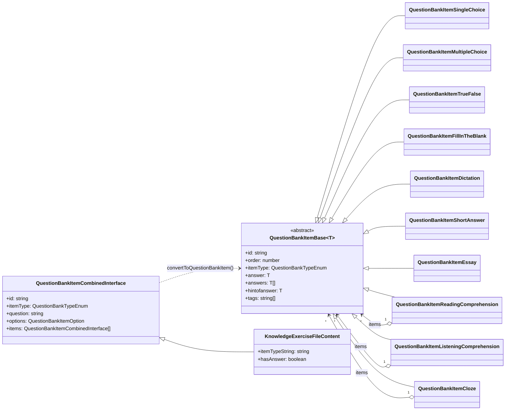
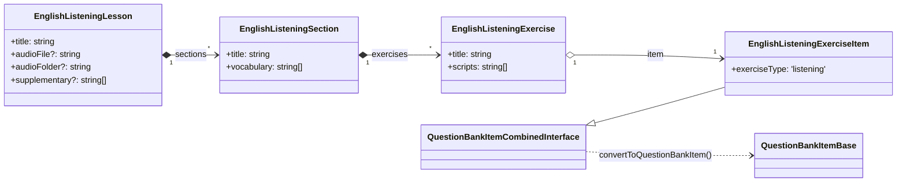
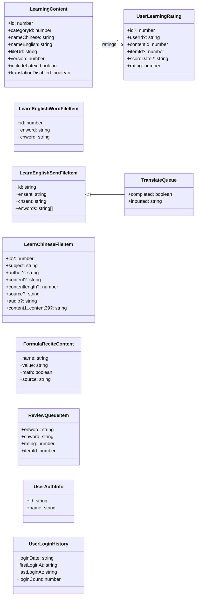
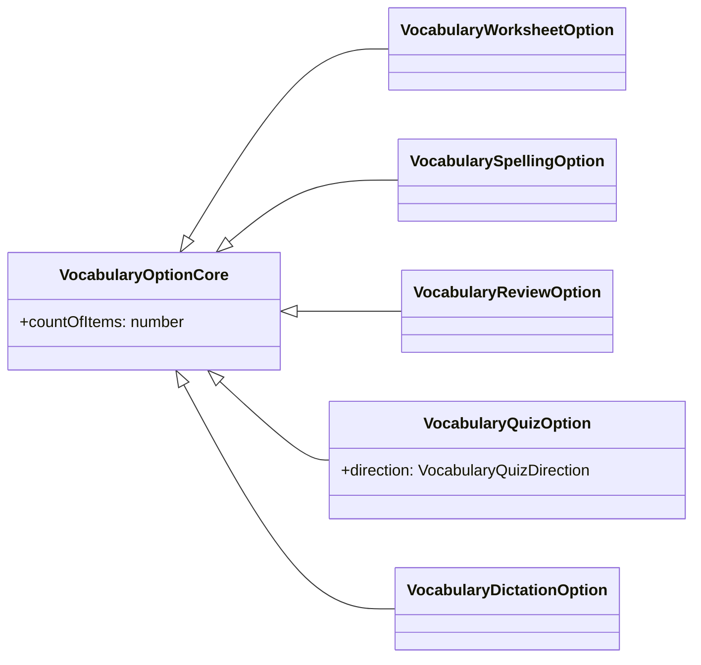
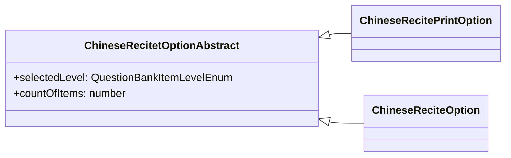

## Data Models

`src/app/interfaces/` defines the data model. 

Each content category maps to a concrete data model loaded by `LearningContentService` (see [Content Data](#content-data) for the full category → method → storage-subfolder table). `LearningContent` is the common file-list record the API returns for every category; the per-category content models are:

| Cat ID | Category | Content data model | Interface file |
|---|---|---|---|
| 1 | Vocabulary | `LearnEnglishWordFileItem` | `learnenglish.ts` |
| 2 | Sentences | `LearnEnglishSentFileItem` (`TranslateQueue extends` it) | `learnenglish.ts` / `translate-data.ts` |
| 3 | Listening | `EnglishListeningLesson` → `EnglishListeningSection` → `EnglishListeningExercise` → `EnglishListeningExerciseItem` | `english-listening.ts` |
| 4 | Chinese | `LearnChineseFileItem` | `learnchinese.ts` |
| 5 | Formula | `FormulaReciteContent` | `formula-recite-queue.ts` |
| 6 | Knowledge Bank | `KnowledgeExerciseFileContent` → `QuestionBankItemBase` via `convertToQuestionBankItem()` | `questionbank-base.ts` |

- **QuestionBank** (`interfaces/questionbank.ts`) — Enums for question types (`QuestionBankTypeEnum`), content formats, option keys, and item levels.
- **QuestionBankItemBase** (`interfaces/questionbank-base.ts`) — Abstract base class for all question types. Concrete implementations: `QuestionBankItemSingleChoice`, `QuestionBankItemMultipleChoice`, `QuestionBankItemFillInTheBlank`, `QuestionBankItemDictation`, `QuestionBankItemShortAnswer`, `QuestionBankItemEssay`, `QuestionBankItemReadingComprehension`, `QuestionBankItemListeningComprehension`, `QuestionBankItemCloze`, `QuestionBankItemTrueFalse`.
- **convertToQuestionBankItem()** — Converts `QuestionBankItemCombinedInterface` (raw JSON) to concrete `QuestionBankItemBase` instances.
- **UserLoginHistory** (`interfaces/user-login-history.ts`) — One day of the caller's login history, served by `api/UserLoginHistories` (`loginDate` yyyy-MM-dd, `firstLoginAt`/`lastLoginAt` UTC instants, `loginCount` — server-deduplicated: a POST within 5 minutes of the day's last accepted sign-in is a duplicate report and changes nothing, so the count means distinct sign-ins, not client calls). The user-detail page reads it via `UserLoginHistoryService.getHistory()`; the SPA records it by calling `recordLogin()` when an OIDC redirect completes (see [authentication-flow.md](authentication-flow.md)).
- **UserLearningTime** (`interfaces/user-learning-time.ts`) — One `(day, category)` row of the caller's server-credited learning time from `api/UserLearningTimes` (`learnDate` yyyy-MM-dd, `categoryId` 1-6, `learningSeconds`, `lastBeatAt` UTC instant). Companion models: `LearningTimePreferences` (`{ leaderboardOptOut }`, GET/PUT …/Preferences) and `LearningTimeLeaderboardEntry` (`{ userId, userName, totalSeconds }`, GET …/Leaderboard). Consumed by `UserLearningTimeService` (heartbeat echo, user-detail cards, homepage Top Learners).
- **WordDictionaryEntry** (`interfaces/word-dictionary.ts`) — One word's dictionary detail served by `api/WordDictionary` from `words.db`: `word` (the canonical DB spelling, spelling variants resolved via `base_word`), `definitions[]` (`partOfSpeech` — empty for phrase glosses — plus Chinese `meaning`), `examples[]` (English `source` + Chinese `translation`, capped at 10 server-side). Consumed by `WordDictionaryService.getWord()` in the vocabulary review screen; mirrors the backend `WordDictionaryDto`.

The diagram shows the core `QuestionBankItemBase` hierarchy, the raw-JSON `QuestionBankItemCombinedInterface` that `convertToQuestionBankItem()` turns into concrete items, the content-record types loaded by `LearningContentService`, and the option/queue interfaces.

### Listening

### Mapping with API Structure

#### Word item contract

Every source of `LearnEnglishWordFileItem` applies the same content rule:
**`enword` must be longer than one character.**

- Server files: `LearningContentService` filters out shorter words when loading
  (`getVocabularyWordContent` and the cache setter).
- Temp files uploaded via the vocabulary page's "Add Temp. File": the container
  rejects the whole upload if any item's `enword` is one character or empty,
  so a temp file can never inject words the service would have filtered.

### Vocabulary Options

(`VocabularyDictationOption` is a type alias of `VocabularyOptionCore` — dictation takes only the item count.)

`VocabularyQuizOption` drives the vocabulary page's Test exercise: it generates
single-choice questions (`buildVocabularyQuizQuestions`) - either EN word ->
pick the correct CN explanation among 4 candidates (`en2cn`) or the reverse
(`cn2en`) - answered interactively in a `VocabularyQuizSessionStore` session
(`VocabularyQuizQuestion` / `VocabularyQuizQueueResult`).

### Chinese Options

Enums (`QuestionBankTypeEnum`, `QuestionBankContentFormatEnum`, `QuestionBankItemLevelEnum`, `SelectionModeEnum`, `RatingOperatorEnum`, `PrintExecDateEnum`, `ChineseReciteStatusEnum`, `EnglishListeningStatusEnum`, `TranslateDirectionEnum`, `FormulaReciteAIModeEnum`, `TranslationAIModeEnum`, etc.) and the status/queue interfaces (`VocabularySpellingQueue`, `VocabularySpellingQueueResult`, `VocabularySpellingLetter`, `TranslateExerciseUIStatus`, `ChineseReciteStatus`, `EnglishListeningUIStatus`) are omitted from the diagram for readability.
